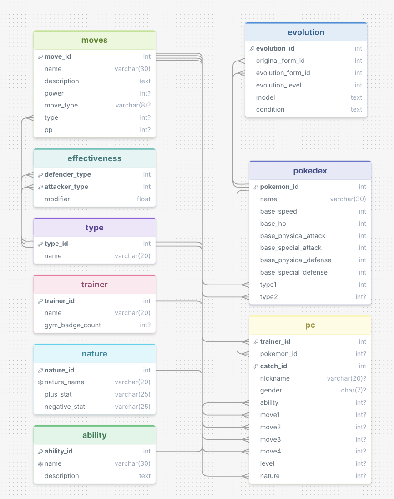

# Description

This code utilizes a database based on information on the HeartGold / SoulSilver 
generation of Pokemon Games. Utilizing this information, a user's question is
passed to AI (in my case Gemini since it has a free API key) to create a
SQLLite SELECT statement to query my database. Then the result of the query
is returned back to AI to create a friendly response to return back to the user.

Most of this code is the base code given from Professor Reynolds or generated
using Codex.

> [!WARNING]
> If you plan on using this code, note that Gemini's free API key
usually only lasts for about 5 or so questions to be asked to it, meaning you
will either want to have multiple accounts with multiple API keys if you want
to run this quite a few times, or you will want to swap to using a different
AI API key (such as back to OpenAI) if wanted.

## Database Schema Picture



## Example Questions

One question that worked really well was the simple request to list the top 5 pokemon
with the highest base stat total (bst). This was easy because it was simply a order by
and limit by 5. The hard part was calculating the base stat total in SQL, which
actually was really easy because I told AI to do it, and it created a function to add
up all the base stats in the pokedex.
```json
    "question": "What are the top 5 pokemon with the highest bst?",
    "sql": "SELECT name FROM pokedex ORDER BY (base_speed + base_hp + base_physical_attack + base_special_attack + base_physical_defense + base_special_defense) DESC LIMIT 5;",
    "queryRawResponse": "[('Mewtwo',), ('Lugia',), ('Ho-Oh',), ('Dragonite',), ('Mew',)]",
    "friendlyResponse": "Here are the top 5 Pok\u00e9mon with the highest base stat totals from that list:\n\n1. Mewtwo\n2. Lugia\n3. Ho-Oh\n4. Dragonite\n5. Mew",
    "error": "None"
```

One question that worked but maybe not as well as it should have, was telling the AI that
a new trainer named Misty appeared with 2 pokemon and their moves, and I asked AI to tell 
me which 3 Pokemon Red has (Red having just about every fully evolved Pokemon) that would be
good offensively and 3 Pokemon that would be good defensively. I had gotten answers such as
Jumpluff, Bellossom, Tangrowth Pikachu, and Victreebel for offense, and Cloyster, Dewgong, 
Lapras, Gengar, and Misdreavus for offensive. And weirdly, I also encountered a weird bug 
where one of my friendlyResponses generated different information then my Query where I had Zapdos, 
Dragonite, and Tyranitar are good offensively while Blissey, Empoleon, and Ferrothorn are good
defensively which is extra weird since Empoleon and Ferrothorn don't exist in my database. 

```json
"zero_shot": [
    "response_one": {
        "queryRawResponse": "[('Jumpluff', 'Cloyster'), ('Bellossom', 'Dewgong'), ('Tangrowth', 'Lapras')]",
        "friendlyResponse": "Here are the three best offensive and defensive Pok\u00e9mon Red could bring to counter that team:\n\n### **Best Offensive Pok\u00e9mon**\n1. **Zapdos:** Packs high Special Attack and Speed to easily eliminate Starmie with Electric STAB, while hitting Kingdra with strong neutral damage.\n2. **Dragonite:** Hits Kingdra super-effectively with powerful Dragon STAB moves (like *Outrage* or *Dragon Claw*) and overwhelms Starmie with brute physical strength.\n3. **Tyranitar:** Shuts down Starmie with super-effective Dark-type moves, while its sandstorm boosts its Special Defense to easily handle special attacks from both opponents.\n\n---\n\n### **Best Defensive Pok\u00e9mon**\n1. **Blissey:** Massive HP and Special Defense completely wall every special move on both Kingdra (*Hydro Pump, Dragon Pulse, Blizzard*) and Starmie (*Surf, Swift*).\n2. **Empoleon:** Its Water/Steel typing resists Kingdra\u2019s Dragon Pulse and Hydro Pump, takes 4x reduced damage from Ice moves (*Blizzard*), and resists all of Starmie's attacks.\n3. **Ferrothorn:** Resists all Water moves, takes neutral damage from Blizzard and Dragon Pulse, and can easily stall with *Leech Seed* and *Protect*.",
    },
    "response_two": {
        "queryRawResponse": "[('Bellossom', 'Gengar'), ('Pikachu', 'Misdreavus'), ('Victreebel', 'Cloyster')]",
        "friendlyResponse": "[('Bellossom', 'Gengar'), ('Pikachu', 'Misdreavus'), ('Victreebel', 'Cloyster')]",        
    }
],
"single_response_double_shot": [
    "response_one": {
        "queryRawResponse": "[('offensive', 'Bellossom'), ('offensive', 'Jumpluff'), ('offensive', 'Tangrowth'), ('defensive', 'Dewgong'), ('defensive', 'Cloyster'), ('defensive', 'Lapras')]",
        "friendlyResponse": "[('offensive', 'Bellossom'), ('offensive', 'Jumpluff'), ('offensive', 'Tangrowth'), ('defensive', 'Dewgong'), ('defensive', 'Cloyster'), ('defensive', 'Lapras')]",
    },
    "response_two": {
        "queryRawResponse": "[('Bellossom', 'Dewgong'), ('Jumpluff', 'Cloyster'), ('Tangrowth', 'Lapras')]",
        "friendlyResponse": "Here is a clear breakdown of those choices for Red:\n\n**Top 3 Offensive Pok\u00e9mon:**\n1. Bellossom\n2. Jumpluff\n3. Tangrowth\n\n**Top 3 Defensive Pok\u00e9mon:**\n1. Dewgong\n2. Cloyster\n3. Lapras",
    }
]
```

## Strategies I used

Generally I used only two strategies, the two strategies that were already in db_bot.py;
the zero_shot and single_response_double_shot. I think that generally for the simple questions
zero_shot was good and created a response that worked fine. But for harder questions, 
having the single_response_double_shot give an example of how the queries work and how
the friendly response should work, it really helped the AI create a better SQL query
and response, but it did take longer than just the zero_shot did. 
